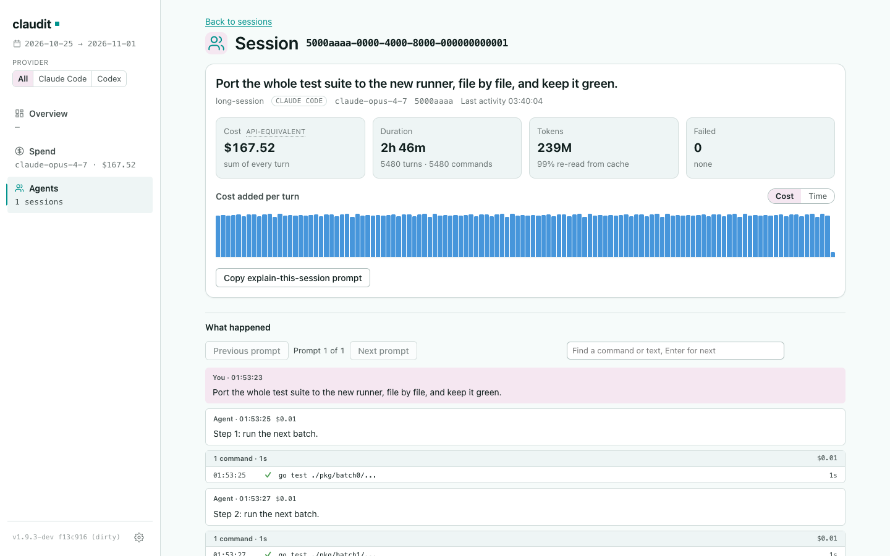
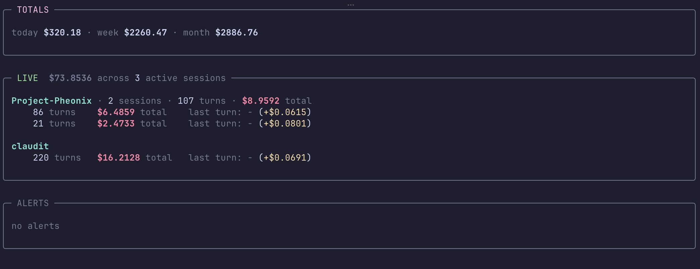

# claudit

[](https://github.com/kurofune/claudit/actions/workflows/ci.yml)
[](https://github.com/kurofune/claudit/releases)
[](LICENSE)

Audit your Claude Code sessions — what your agents actually did, and what it cost.



claudit is a local web app over the `.jsonl` session logs that Claude Code writes under `~/.claude/projects/`. Run `claudit serve` and open the dashboard in your browser: it re-reads the logs as new turns land and shows where the money went — by project, model, tool, subagent, and individual user prompt.

Its centrepiece is the **Agents** view: a full trace of what each session's agents actually did — every turn, tool call, and sub-agent on a real timeline, with automatic anomaly detection. See [The Agents view](#the-agents-view). For a terminal, `claudit watch` tails a live session and shows its cost accruing.



## Install

```sh
go install github.com/kurofune/claudit/cmd/claudit@latest
```

Requires Go 1.26 or later. The binary lands in `$GOBIN` (usually `~/go/bin`).

## Quick start

```sh
# Run the local web daemon — auto-reloads as new turns land, filter via URL
claudit serve                         # http://127.0.0.1:8787 (bare `claudit` does the same)
claudit serve --port=9000 --open=false
# Filters live in the query string, views in the URL hash:
#   http://127.0.0.1:8787/?project=myrepo&last=7d
#   http://127.0.0.1:8787/?since=2026-05-01&until=2026-05-15&by=week#spend
#   http://127.0.0.1:8787/#spend/project/tokens   # Spend by project, in tokens
#   http://127.0.0.1:8787/#agents                 # the Agents trace viewer
#   http://127.0.0.1:8787/#agents/timeline        # deep-link a specific lens

# Tail the currently-running session and watch cost accrue
claudit watch --budget=5.00

# Or tail every recently-modified session under ~/.claude/projects, grouped by project
claudit watch --all
```

Run `claudit help` for the subcommand list and `claudit <cmd> --help` for per-command flags.

Date filters (serve's `?since` / `?until`) are calendar dates interpreted at midnight in your **local** time zone — consistent with `?last` and the `watch` rolling totals.

## What it shows

- **Overview.** Turns, sessions, tokens (input / output / cache-read / 5m-cache-write / 1h-cache-write), cost in USD, cache hit ratio, and the time range covered.
- **Spend.** One view with a Dollars / Tokens toggle, split by model, project, subagent, skill and slash command, and top prompts, with trend charts. Projects are grouped by git repo root, so a repo's worktrees and subdirectories roll up into one row.
- **Tools.** Bash, Read, Edit, Grep, WebFetch, etc., with drill-down into Bash patterns, file extensions read, grep globs, and web hosts fetched.
- **Subagent attribution.** Sidechain (subagent) cost separated from main-thread cost, with per-invocation rows and per-agent-type roll-ups.
- **Per-prompt cost.** Every user prompt's downstream cost, computed by walking the conversation's parent links (Spend → By top prompts).
- **Hotspots.** Top cost drivers with a copyable LLM prompt for each, so you can paste the prompt into a model and get specific advice on that exact driver.
- **Agent traces.** The Agents view reconstructs each session turn-by-turn — the ordered user prompts and the assistant turns each one produced, every tool call (with the exact input/output), and every sub-agent — on a timeline, with automatic anomaly detection. See [The Agents view](#the-agents-view).
- **Trends and anomalies.** Day/week/month buckets; buckets with abnormal cost spikes or cache hit-ratio drops are flagged inline on the chart.

## The Agents view

The **Agents** tab turns the raw transcript into a trace you can actually read and audit — not just "where did the money go," but "what did the agent *do*." Open it at `http://127.0.0.1:8787/#agents`.

Everything you click — an agent, a turn, or a single tool call — fills one shared **detail drawer** on the right (input, output, status, reasoning, tokens, cost, model, duration), and the selection persists as you switch between five lenses over the same data:

- **Feed** — a live, newest-first stream of activity. Currently-running agents pin to the top as sticky "live" rows and update in place every couple of seconds; your scroll, selection, and open panels stay put.
- **Tree** — the drill-down. Pick any agent and read its step-by-step tool log, with sub-agents nested under the call that spawned them, per-turn reasoning, and the exact input each tool sent and the output it got back (✓/✗). Cost and error counts roll up onto parents.
- **Timeline** — a Gantt on a real time axis: one row per agent, indented by who spawned whom, bar width = lifetime, overlap = concurrency. Bars are tiled into per-turn segments colored by tool kind, with idle-gap and critical-path marks, a draggable **playhead** that replays the trace at any instant, and scroll-wheel zoom.
- **Conversation** — the prompt-by-prompt thread for a single session, with a session picker.
- **Insights** — an analytical dashboard, each section its own tab: **Signals** (automatic anomaly detection — cost whales, retry storms, slow tools, error cascades, idle stalls — worst-first, click-through to the Timeline), **Tool mix**, **Cost Pareto**, **Latency**, **Errors**, **Token & context**, and **Group by** (kind/model/agent/status). A Graph / Session / Agent scope toggle re-slices every panel except the graph-wide Signals.

A trace filter (kind, cost, duration, errors, free text) dims non-matching steps across every lens at once. Deep-link a specific lens with `#agents/<lens>` (e.g. `#agents/timeline`, `#agents/insights`). Prompt and tool-I/O content is shown in full — see [Privacy](#privacy).

## Privacy

claudit runs entirely on your machine:

- It reads `.jsonl` files already on disk (the ones Claude Code wrote there).
- It reads a local pricing YAML.
- `claudit serve` binds `127.0.0.1` by default, so only your own machine can reach the dashboard. It has no authentication; `--bind=0.0.0.0` exposes it to your LAN, at your own risk.

No session data leaves the machine: claudit makes no network calls and writes no report files. The one external request is the dashboard's typography — the browser loads Inter from Google Fonts, so your IP and User-Agent reach `fonts.googleapis.com`, but none of your prompts, paths, or costs do. Offline, it falls back to system sans-serif. Hotspot prompts are copyable text — pasting them into a model is your decision.

The dashboard shows your prompt text and tool input/output in full. Keep that in mind before screen-sharing it or exposing the port beyond loopback.

## Pricing config

claudit ships with bundled default prices embedded in the binary, refreshed each release against [Anthropic's pricing page](https://platform.claude.com/docs/en/about-claude/pricing). You don't need to do anything for those to take effect — upgrade and the new rates apply.

If you have custom rates (enterprise discounts, private-preview models, or a stopgap entry for a model the next release hasn't shipped yet), create `~/.config/claudit/prices.yaml`. Entries there **overlay** the bundled defaults per-model: any model you define replaces the bundled entry for that name, and bundled entries you didn't touch stay intact. The file is per-million-token USD rates:

```yaml
models:
  claude-opus-4-7:
    input_per_mtok: 15.00
    output_per_mtok: 75.00
    cache_read_per_mtok: 1.50
    cache_write_5m_per_mtok: 18.75
    cache_write_1h_per_mtok: 30.00
```

Prices are keyed by provider, then model. The bare top-level `models:` map above is Claude Code's; to price another provider's models, list them under `providers:` — an entry replaces the bundled one for that (provider, model) pair, or adds it:

```yaml
providers:
  codex:
    models:
      gpt-6:
        input_per_mtok: 1.25
        output_per_mtok: 10.00
```

`providers: {claude-code: {models: …}}` is the same as the bare form. Override the path with `--prices=path/to/file.yaml`. Models that appear in your sessions but are missing from both the bundle and your overlay show up in the report's `unknown_models` block, named `provider/model` (e.g. `claude-code/claude-future-9`), with zero attributed cost — and claudit prints the turn count and token volume behind each one on stderr, so you can tell whether the gap is worth fixing. Add them to your YAML to get them priced.

### Fast-mode rates

When a turn carries `message.usage.speed: "fast"`, claudit uses the model's
optional `fast:` block. It accepts the same five per-million-token USD fields:

```yaml
models:
  claude-opus-5-5:
    input_per_mtok: 4.00
    output_per_mtok: 20.00
    cache_read_per_mtok: 0.20
    cache_write_5m_per_mtok: 5.00
    cache_write_1h_per_mtok: 8.00
    fast:
      input_per_mtok: 8.00
      output_per_mtok: 40.00
      cache_read_per_mtok: 0.40
      cache_write_5m_per_mtok: 10.00
      cache_write_1h_per_mtok: 16.00
```

Standard, missing, or unrecognized speeds use the standard rate. Fast turns
also use the standard rate when the model has no `fast:` block. The fast block
is a flat current rate; `rates:` history applies only to standard pricing.
Overlays replace the entire model, including `fast:` and `rates:`; omitting
`fast:` in an override removes that model's bundled fast rates.

### Long-prompt rates

Some models charge more for long prompts. An optional `long_prompt:` block
holds `threshold_tokens` plus the same five per-million-token USD fields. When
a standard-speed turn's prompt (input + cache reads + cache writes) is over the
threshold, every token in that turn, output included, prices at the block's
rates. Output tokens never count toward the threshold. Each turn is checked on
its own, and fast mode wins over the tier. Bundled Haiku 5.5 uses it:

```yaml
models:
  claude-haiku-5-5:
    input_per_mtok: 0.10
    output_per_mtok: 0.50
    cache_read_per_mtok: 0.01
    cache_write_5m_per_mtok: 0.125
    cache_write_1h_per_mtok: 0.20
    long_prompt:
      threshold_tokens: 100000
      input_per_mtok: 0.50
      output_per_mtok: 2.50
      cache_read_per_mtok: 0.05
      cache_write_5m_per_mtok: 0.625
      cache_write_1h_per_mtok: 1.00
```

Like `fast:`, the tier is a flat current rate, and an overlay that omits
`long_prompt:` removes the model's bundled tier.

### Rates that change over time

claudit prices *historical* sessions, so a rate change isn't a simple edit: bump the number and old turns re-price at rates that were never charged; leave it and new turns are wrong. A model's top-level fields are therefore the rate in effect **now**, and an optional `rates:` list holds what came before:

```yaml
models:
  some-model:                     # illustrative — a model whose rate was cut
    input_per_mtok: 2.00          # in effect now
    output_per_mtok: 10.00
    cache_read_per_mtok: 0.20
    cache_write_5m_per_mtok: 2.50
    cache_write_1h_per_mtok: 4.00
    rates:
      - until: 2026-08-31         # inclusive — the old, higher rate
        input_per_mtok: 3.00
        output_per_mtok: 15.00
        cache_read_per_mtok: 0.30
        cache_write_5m_per_mtok: 3.75
        cache_write_1h_per_mtok: 6.00
```

No bundled model currently carries a `rates:` list — Sonnet 5's introductory
window did until the increase it preceded was cancelled — so the mechanism is
there for the next real rate change and for your own overlay.

Each turn is priced at the rate in effect when it ran. `until` is **inclusive** and interpreted in UTC — the period covers everything through 23:59:59 on that date. Periods may be listed in any order; claudit picks the narrowest one covering the turn. A turn with no usable timestamp prices at the current (top-level) rate.

The `rates:` key is optional and purely additive — an overlay written in the flat form keeps working unchanged. Overlay semantics are unchanged too: defining a model replaces the bundled entry **entirely**, rate history included, so a flat override makes your rate apply at every timestamp.

## Subcommands

| Command | Purpose |
|---|---|
| `serve` | Run the local web daemon: a live dashboard that re-reads the JSONLs as they change and hosts the [Agents](#the-agents-view) trace viewer. Default when no subcommand is given. |
| `watch` | Tail the active session (or every recently-modified session with `--all`) in a full-screen TUI, with rolling hour/today/week/month totals, spike detection, and budget alerts. |
| `version` | Print the installed claudit version (also `--version`). |

`claudit help` shows the subcommand list; `claudit <cmd> --help` shows per-command flags.

## Status and limitations

- The JSONL schema is Claude Code's. If Anthropic changes it, the parser may need to catch up.
- Prices are manually maintained in `prices.yaml`. When Anthropic publishes new rates, you update the YAML.
- Developed and dogfooded on macOS. CI runs the test suite on Linux, macOS, and Windows. On Windows, `claudit watch`'s live status line uses ANSI escape sequences — Windows Terminal and PowerShell 7 render them correctly; legacy `cmd.exe` will show the escapes literally.
- Desktop browsers only; the dashboard has no mobile layout.

## License

MIT — see [LICENSE](LICENSE).
